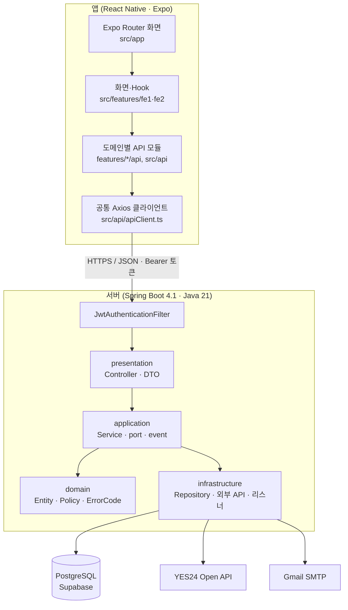
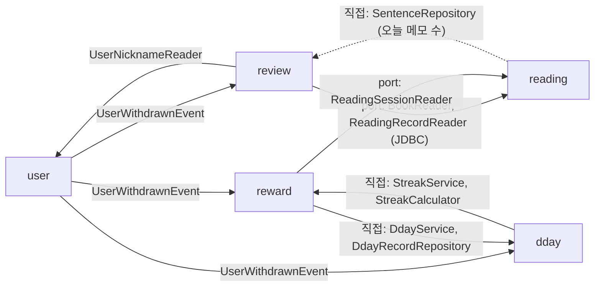

> 기준: main@82df578 + 스펙 004 · 최종 확인: 2026-11-22 · 담당: BE1

# 아키텍처

## 1. 전체 구성



| 계층 | 책임 |
|---|---|
| presentation | HTTP 요청·응답, 입력값 검증, DTO 변환. Entity를 그대로 응답하지 않는다 |
| application | 유스케이스 실행, 트랜잭션, 다른 도메인과의 연결 |
| domain | 핵심 규칙(페이지 범위, 경험치 계산 등)과 상태 변경 |
| infrastructure | DB, 외부 API(YES24·메일), port 구현, 이벤트 리스너, 초기 데이터 |

## 2. 백엔드 도메인

| 도메인 | 패키지 | 담당 | 문서 |
|---|---|---|---|
| reading | `com.chaekdami.reading` | BE1 | [domains/reading](./domains/reading/) |
| review | `com.chaekdami.review` | BE3 | [domains/review](./domains/review/) |
| reward | `com.chaekdami.reward` | BE2 | [domains/reward](./domains/reward/) |
| dday | `com.chaekdami.dday` | BE2 | [domains/dday](./domains/dday/) |
| user | `com.chaekdami.user`, `com.chaekdami.config` | BE3 | [domains/user](./domains/user/) |
| 공통 | `com.chaekdami.global` | — | `ErrorCode`, `BusinessException`, `PageResponse`, `BaseTimeEntity` |

## 3. 도메인끼리 연결

다른 도메인의 데이터가 필요할 때는 **port 인터페이스**(application에 정의, infrastructure에서 구현)나 **이벤트**를 쓰는 것이 원칙이다. 일부는 아직 직접 참조한다.



| 연결 | 방식 | 위치 |
|---|---|---|
| 회원 탈퇴 → 독후활동·보상·D-day 삭제 | 이벤트 `UserWithdrawnEvent` | `*CleanupListener` |
| 독후활동 → 책·독서 기록 조회 | port (`BookReader`, `ReadingRecordReader`) + JDBC 구현 | `review/application/port`, `review/infrastructure/Jdbc*` |
| 보상 → 독서 세션 조회 | port (`ReadingSessionReader`) | `reward/infrastructure/ReadingSessionRepositoryReader` |
| 보상 → 사진 인증 여부 | port (`PhotoCertificationChecker`) — 세션에 연결된 독서 인증 조회 | `CertificationPhotoChecker` → `CertificationService.isPhotoCertified` |
| 보상 ↔ D-day | 서로 직접 참조 (연속일 계산을 함께 씀) | `ReadingSessionRewardService`, `StreakService`, `DdayService` |
| 독서 → 문장 수 | 직접 참조 | `TodayReadingService` |
| 독후활동 이벤트 (`ReviewCreatedEvent` 등) | 발행만 하고 받는 곳 없음 | `review/application/event` |

> ⚠️ [ISSUE-DATA-2](./known-issues.md#issue-data-2) 회원 탈퇴 시 reading 데이터(서재·기록·세션)를 지우는 리스너는 없다.
>
> ⏳ [TODO-19](./known-issues.md#todo-19) reward ↔ dday 직접 참조

## 4. 핵심 흐름

### 4.1 독서 → 보상

```
[FE1 독서 종료] POST /api/reading-sessions ──▶ 세션 저장, 현재 페이지·완독 갱신 (보상 처리 없음)
      ◀── { id(=readingSessionId), readingRecordId, status, ... }
[FE2 독서 완료 화면] 진입 시
      POST /api/rewards/reading-sessions/{readingSessionId}
      ──▶ 경험치(+부스터) · 퀘스트 진행·지급 · D-day 기록 · 레벨업 — 세션당 1번
      ◀── 지급 내역 (다시 부르면 처음 내역을 그대로)
      GET /api/quests (퀘스트 표시)
```

자세히: [domains/reward/rules.md](./domains/reward/rules.md), 결정 배경: [decisions/0003](./decisions/0003-reward-on-complete-screen.md)

### 4.2 로그인

```
POST /api/auth/login → Access(15분) + Refresh(90일) 발급
요청마다 Authorization: Bearer … → JwtAuthenticationFilter 검증 (token_version 비교)
401 → 앱이 POST /api/auth/refresh로 재발급 후 재시도
```

자세히: [domains/user/rules.md](./domains/user/rules.md), [conventions/api.md](./conventions/api.md#2-인증)

## 5. 프론트엔드

### 폴더

```text
frontend/src/
├── app/                 # Expo Router 라우트 파일 (얇게: 화면 컴포넌트를 불러오기만)
│   ├── _layout.tsx
│   ├── index.tsx        # → home.tsx (토큰 없으면 /auth/login으로)
│   ├── home.tsx
│   ├── auth/            # login · signup · forgot-password
│   ├── fe1/             # 서재·검색·등록·독서·커뮤니티
│   ├── fe2/             # user · review · reward · reading(완료)
│   └── reward/level.tsx
├── features/
│   ├── fe1/             # api · components · hooks · screens · constants · types · utils · assets
│   └── fe2/             # api · components · hooks · screens · types
├── api/                 # apiClient.ts (공통 Axios), authApi.ts
├── components/          # 공용 컴포넌트 (BottomTabBar, Toast …)
├── constants/routes.ts  # 앱 전체 라우트 상수 ROUTES, to*() 이동 함수
└── utils/               # tokenStorage(SecureStore), navigation
```

### 파트 나눔

| 파트 | 범위 | 화면 |
|---|---|---|
| FE1 | 서재, 도서 검색·등록, 서재 꾸미기, 독서 시작·종료, 커뮤니티 | `features/fe1/screens` |
| FE2 | 홈, 로그인·가입, 마이페이지, 독서 통계, D-day, 보상·퀘스트·상점, 독서 완료, 독후감 | `features/fe2/screens` |

### 라우트

화면 코드에서는 경로 문자열 대신 `ROUTES`와 `to*()` 함수를 쓴다 (`src/constants/routes.ts`).

| 경로 | 화면 |
|---|---|
| `/` | 홈 |
| `/auth/login` · `/auth/signup` · `/auth/forgot-password` | 로그인 · 가입 · 비밀번호 찾기 |
| `/fe1/library` · `/fe1/library-customize` | 서재 · 서재 꾸미기 |
| `/fe1/book-search` · `/fe1/book-info` · `/fe1/book-register` · `/fe1/manual-register` | 검색 · 책 정보 · 등록 · 직접 등록 |
| `/fe1/book-detail` | 서재 책 상세 |
| `/fe1/reading-start` · `/fe1/reading-end` | 독서 시작(타이머) · 독서 종료 |
| `/fe1/community` | 완독자 커뮤니티 |
| `/fe2/reading/reading-complete` | 독서 완료(보상) |
| `/fe2/review/review-write` · `/fe2/review/review-detail` | 독후감 작성 · 보기 |
| `/fe2/user/mypage` · `/fe2/user/reading-stats` | 마이페이지 · 독서 통계 |
| `/fe2/reward/reward` · `/fe2/reward/quest` · `/fe2/reward/shop` · `/fe2/reward/dday` | 레벨·보상 · 퀘스트 · 상점 · D-day |

### API 모듈

| 모듈 | 부르는 API |
|---|---|
| `src/api/authApi.ts` | `/api/auth/*`, `/api/me` |
| `features/fe1/api/readingApi.ts` | 검색, 서재, 독서 기록, 세션, 문장 |
| `features/fe1/api/communityApi.ts` | 리뷰(평점·한줄평), 좋아요, 신고, 평점 요약 |
| `features/fe1/api/photoVerifyApi.ts` | `POST /api/reading-records/{id}/certifications` — 독서 인증 (가장 최근 회차) |
| `features/fe2/api/rewardApi.ts` | 보상, 독서 완료 보상, 부스터, 퀘스트, 상점 |
| `features/fe2/api/ddayApi.ts` | D-day |
| `features/fe2/api/reviewApi.ts` | 독후감 |
| `features/fe2/api/todayReadingApi.ts`, `readingStatsApi.ts` | 오늘 독서, 독서 통계 |
| `features/fe2/api/userApi.ts` | 내 정보, 비밀번호 변경, 탈퇴 |

경로 일치 여부는 `python3 scripts/harness/contract-check.py`로 확인한다.
