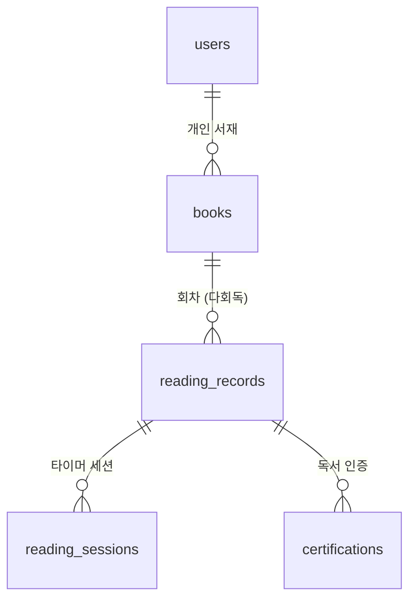

> 기준: main@82df578 + 스펙 004 · 최종 확인: 2026-11-22 · 담당: BE1

# reading 데이터

테이블은 JPA 엔티티로 생성된다 (`ddl-auto=update`, 마이그레이션 파일 없음). 세 테이블은 `BaseTimeEntity`를 쓰지 않는다.

## 관계

| 관계 | 설명 |
|---|---|
| users 1 : N books | 같은 책도 사용자마다 별도 행. 서로의 서재는 보이지 않는다 |
| books 1 : N reading_records | 완독한 책을 다시 읽으면 기존 기록을 덮지 않고 새 회차를 만든다 |
| reading_records 1 : N reading_sessions | 회차 동안 타이머를 켤 때마다 쌓인다. 총 독서 시간 = 세션 합 |
| reading_records 1 : N certifications | 회차에 올린 인증 사진의 판정 결과. 사진을 붙일 때의 가장 최근 회차라, 다회독 첫 세션의 인증은 이전 회차에 붙는다 |
| reading_sessions 1 : 0..1 certifications | 세션 저장 때 통과한 인증을 연결 (`reading_session_id`, 외래 키 아닌 숫자 칸). 사진 인증 보상 판단에 쓴다 |

`reading_records.user_id`·`reading_sessions.user_id`는 조회 편의용으로 함께 저장한다 (항상 책 주인과 같다).

## books

엔티티: `Book`

| 컬럼 | 타입 | 제약 | 설명 |
|---|---|---|---|
| id | bigint | PK | `bookId` |
| user_id | bigint | not null | 서재 주인 |
| item_id | bigint | | YES24 상품 번호. 직접 입력한 책은 `null` |
| title | varchar | not null | |
| author | varchar | | YES24 형식 그대로 (예: "제임스 클리어 저/이한이 역") |
| isbn | varchar | | 13자리, 하이픈·공백 제거. 없으면 `null` |
| publisher | varchar | | |
| published_date | varchar | | `YYYY-MM-DD` |
| cover_url | varchar | | |
| description | text | | |
| total_pages | int | not null | 1 이상. 독서율 기준 |

UNIQUE `uk_books_user_id_item_id` (user_id, item_id) — 같은 YES24 책 중복 등록 방지. `item_id`가 `null`인 직접 입력 책은 제한하지 않는다.

## reading_records

엔티티: `ReadingRecord`

| 컬럼 | 타입 | 제약 | 설명 |
|---|---|---|---|
| id | bigint | PK | `readingRecordId` |
| user_id | bigint | not null, INDEX `idx_reading_records_user_id` | |
| book_id | bigint | FK → books | |
| round | int | not null | 회차 1, 2, … |
| status | varchar(20) | not null | `NOT_STARTED` · `IN_PROGRESS` · `COMPLETED` |
| current_page | int | not null | |
| goal_date | date | | 목표 완독 날짜 |
| goal_page | int | | 하루 목표 페이지 |
| memo | varchar(200) | | |
| is_public | boolean | not null | 이 회차의 **문장 모음집** 공개 여부. 기본 비공개 ([review/rules.md](../review/rules.md#1-문장과-모음집)) |
| started_at | timestamp | | 처음 페이지를 넘긴 시각 |
| completed_at | timestamp | | |
| created_at | timestamp | not null | |
| updated_at | timestamp | | |

UNIQUE `uk_reading_records_book_id_round` (book_id, round)

## reading_sessions

엔티티: `ReadingSession`

| 컬럼 | 타입 | 제약 | 설명 |
|---|---|---|---|
| id | bigint | PK | `readingSessionId` |
| user_id | bigint | not null | |
| reading_record_id | bigint | FK → reading_records | |
| started_at | timestamp | not null | `ended_at − duration_seconds` |
| ended_at | timestamp | not null | 서버가 저장 요청을 받은 시각 |
| duration_seconds | int | not null | 3분~2시간 |
| start_page | int | not null | |
| end_page | int | not null | |
| created_at | timestamp | not null | |

INDEX `idx_reading_sessions_reading_record_id`, `idx_reading_sessions_user_id_started_at` (오늘·이번 주 통계용)

## certifications

엔티티: `Certification`. 사진 파일은 저장하지 않고 AI가 읽은 결과만 저장한다.

| 컬럼 | 타입 | 제약 | 설명 |
|---|---|---|---|
| id | bigint | PK | 인증 번호 |
| user_id | bigint | not null, INDEX `idx_certifications_user_id` | |
| reading_record_id | bigint | FK → reading_records, INDEX `idx_certifications_reading_record_id` | |
| image_url | varchar | | 사진 주소. 사진 저장소가 없어 지금은 항상 `null` |
| extracted_text | text | | AI가 읽은 글자 |
| normalized_text | text | | 소문자·글자·숫자만 남긴 값 (같은 사진 재사용 비교용) |
| detected_page | int | | 사진에서 찾은 쪽 번호 |
| book_page | boolean | | AI 판단: 책 페이지인가 |
| status | varchar(20) | not null | `PASSED` · `UNVERIFIED` · `FAILED` |
| message | varchar(1000) | | 판정 이유 (여러 개면 줄바꿈으로 구분) |
| ai_skipped | boolean | | AI 사용 한도 초과(429)로 확인 없이 통과. `null`은 false (칸이 생기기 전 기록) |
| reading_session_id | bigint | UNIQUE | 이 인증을 쓴 독서 세션. 세션 저장 때 채움, 한 세션에 하나 |
| created_at | timestamp | not null | |

## 삭제

| 상황 | 처리 | 상태 |
|---|---|---|
| 책 삭제 | 인증 → 세션 → 기록 → 책 순서로 삭제 (`BookService.deleteBook`) | ✅ |
| 책 삭제 시 문장·리뷰·독후감·좋아요·신고 | 지우지 않음 | ⚠️ [ISSUE-DATA-1](../../known-issues.md#issue-data-1) |
| 책 삭제 시 보상 내역 | 지우지 않음 | ⚠️ [ISSUE-DATA-3](../../known-issues.md#issue-data-3) |
| 회원 탈퇴 | reading 데이터를 지우는 리스너 없음 | ⚠️ [ISSUE-DATA-2](../../known-issues.md#issue-data-2) |

## 변경 이력

| 시점 | 변경 |
|---|---|
| be/feat/book-reading | `books`를 사용자별 개인 서재로 (`user_id`, `item_id`, UNIQUE 추가), `reading_records`·`reading_sessions` 추가 |
| fix/fe1@56aa7f5 | 세션 최소 시간 3분 검사 추가 (테이블 변경 없음) |
| main@f781a9e (PR #13) | `certifications` 추가 |
