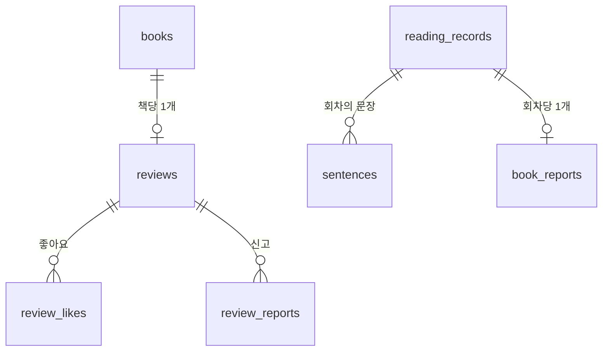

> 기준: fix/be3-review-isbn · 최종 확인: 2026-11-24 · 담당: BE3

# review 데이터

테이블은 JPA 엔티티로 생성된다 (`ddl-auto=update`). `created_at`·`updated_at`은 `BaseTimeEntity` (sentences, reviews, book_reports).
reading 테이블과 FK는 없다. `book_id`·`reading_record_id`·`user_id`는 값만 저장하고, 존재·소유권은 서비스에서 확인한다.

## 관계

## sentences

엔티티: `Sentence`

| 컬럼 | 타입 | 제약 | 설명 |
|---|---|---|---|
| id | bigint | PK | `sentenceId` |
| user_id | bigint | not null, INDEX | |
| reading_record_id | bigint | not null | |
| book_id | bigint | not null, INDEX | |
| read_date | date | not null, 수정 불가 | 저장한 날 (오늘 문장 수 집계) |
| page_number | int | | 선택 |
| content | varchar(500) | not null | |
| created_at, updated_at | timestamp | not null | |

INDEX `idx_sentences_reading_record_id_read_date`, `idx_sentences_user_id`, `idx_sentences_book_id`

## reviews

별점 + 한줄평. 엔티티: `Review`

| 컬럼 | 타입 | 제약 | 설명 |
|---|---|---|---|
| id | bigint | PK | `reviewId` |
| user_id | bigint | not null | |
| book_id | bigint | not null, **UNIQUE** `uk_reviews_book_id` | 책당 1개 |
| isbn | varchar(20) | | 같은 책 묶기용 (정규화). 책 ISBN이 20자를 넘으면 `null` |
| rating | smallint | not null | 1~5 |
| one_line | varchar(100) | | 없으면 `null` |
| is_spoiler | boolean | not null | |
| is_public | boolean | not null | 한줄평 목록 노출 (기본 공개) |
| like_count | int | not null | 원자적 UPDATE로만 변경 |
| report_count | int | not null | 원자적 UPDATE로만 변경 |
| is_blinded | boolean | not null | |
| blinded_at | timestamp | | |
| created_at, updated_at | timestamp | not null | |

INDEX `idx_reviews_user_id`, `idx_reviews_isbn_created_at`, `idx_reviews_isbn_like_count`

## book_reports

독후감. 엔티티: `BookReport`

| 컬럼 | 타입 | 제약 | 설명 |
|---|---|---|---|
| id | bigint | PK | `bookReportId` |
| user_id | bigint | not null, INDEX | |
| reading_record_id | bigint | not null, **UNIQUE** `uk_book_reports_reading_record_id` | 회차당 1개 |
| book_id | bigint | not null, INDEX | |
| content | varchar(2000) | not null | |
| is_public | boolean | not null | 커뮤니티 노출 (기본 비공개) |
| revision | int | not null | 본문이 바뀔 때마다 +1. AI 피드백 기준 본문 판별용 |
| created_at, updated_at | timestamp | not null | |

## review_likes

엔티티: `ReviewLike`. 행은 `insert … on conflict do nothing`으로만 만든다.

| 컬럼 | 타입 | 제약 |
|---|---|---|
| id | bigint | PK |
| review_id | bigint | not null, FK → reviews |
| user_id | bigint | not null, INDEX |
| created_at | timestamp | not null |

UNIQUE `uk_review_likes_review_id_user_id`

## review_reports

엔티티: `ReviewReport`. 블라인드를 풀어도 행은 남겨 같은 사람이 다시 신고하지 못하게 한다.

| 컬럼 | 타입 | 제약 |
|---|---|---|
| id | bigint | PK |
| review_id | bigint | not null, FK → reviews |
| user_id | bigint | not null, INDEX |
| reason | varchar(30) | not null — `SPOILER` · `ABUSIVE` · `SPAM` · `INAPPROPRIATE` · `OTHER` |
| detail | varchar(300) | `OTHER`면 필수 |
| created_at | timestamp | not null |

UNIQUE `uk_review_reports_review_id_user_id`

## 삭제

| 상황 | 처리 | 상태 |
|---|---|---|
| 회원 탈퇴 | `ReviewCleanupListener`가 이 사용자의 독후활동 삭제 | ✅ |
| 책 삭제 | reading 책 삭제가 `ReviewCleanupService.deleteAllOfBook`을 같은 트랜잭션에서 불러 그 책(`book_id`)의 좋아요·신고 → 리뷰 → 독후감 → 문장 삭제 | ✅ |

## 변경 이력

| 커밋 | 변경 |
|---|---|
| `60b822f` | 독후활동 테이블 처음 추가 (옛 설계의 quotes·ratings·one_line_reviews 대신 위 구조) |
| `209eec7` | 문장 모음집 공개를 회차 `is_public`으로 변경, 공개 설정 테이블 제거, ISBN 정규화 규칙을 독서 도메인과 통일 |
