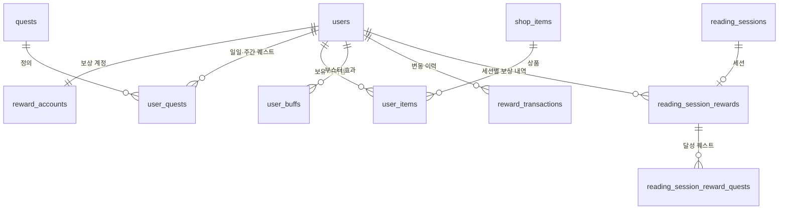

> 기준: fix/fe1@ef397a6 + 스펙 013 · 최종 확인: 2026-11-25 · 담당: BE2

# reward 데이터

테이블은 JPA 엔티티로 생성된다 (`ddl-auto=update`, 마이그레이션 파일 없음).
`created_at`·`updated_at`은 `BaseTimeEntity`를 상속한 엔티티에 자동으로 붙는다 (표에 "시각"으로 표시).

## 관계

FK 제약은 `user_quests.quest_id`, `reading_session_reward_quests.reading_session_reward_id`에만 있다. 나머지 `user_id`·`shop_item_id`·`reading_session_id`는 값만 저장한다.

## reward_accounts

사용자별 보상 상태. 보상 API를 처음 부를 때 생긴다. 엔티티: `RewardAccount`

| 컬럼 | 타입 | 제약 | 설명 |
|---|---|---|---|
| id | bigint | PK | |
| user_id | bigint | not null, **UNIQUE** `uk_reward_accounts_user_id` | |
| currency | int | not null, 초기 0 | 보유 재화 |
| experience | int | not null, 초기 0 | **누적** 경험치 |
| level | int | not null, 초기 1 | |
| dday | int | not null, 초기 0 | 현재 연속 독서 일수 (D-day 달력 계산값을 조회 때 반영) |
| max_dday | int | not null, 초기 0 | 최고 연속 일수 |
| created_at, updated_at | timestamp | not null | 시각 |

조회 시 비관적 쓰기 잠금을 건다 (`RewardAccountRepository.findByUserIdWithLock`, 대기 3초).

## quests

퀘스트 정의. 앱 시작 시 `DailyQuestSeeder`·`WeeklyQuestSeeder`가 `DailyQuest`·`WeeklyQuest` enum에 맞춘다. 엔티티: `Quest`

| 컬럼 | 타입 | 제약 | 설명 |
|---|---|---|---|
| id | bigint | PK | |
| code | varchar(50) | **UNIQUE** `uk_quests_code` | `DailyQuest`·`WeeklyQuest` 상수 이름. 바꾸면 다른 퀘스트가 됨 |
| type | varchar(20) | not null | `DAILY` · `WEEKLY` |
| title | varchar | not null | |
| target_value | int | not null | 목표 수치 |
| reward_currency | int | not null | |
| reward_experience | int | not null | |
| created_at, updated_at | timestamp | not null | 시각 |

## user_quests

사용자에게 출제된 그날의 일일 퀘스트와 그 주의 주간 퀘스트. 엔티티: `UserQuest`

| 컬럼 | 타입 | 제약 | 설명 |
|---|---|---|---|
| id | bigint | PK | `userQuestId` |
| user_id | bigint | not null | |
| quest_id | bigint | not null, FK → quests | |
| progress | int | not null | 현재 진행 값 |
| status | varchar(20) | not null | `IN_PROGRESS` · `COMPLETED` · `REWARDED` |
| completed_at | timestamp | | 달성 시각 |
| created_at, updated_at | timestamp | not null | 시각. **어느 날(일일)·어느 주(주간)의 퀘스트인지는 `created_at`으로 구분** |

## shop_items

상점 상품. 없으면 `ShopItemSeeder`가 넣는다. 엔티티: `ShopItem`

| 컬럼 | 타입 | 제약 | 설명 |
|---|---|---|---|
| id | bigint | PK | 상점 `itemId` |
| name | varchar | not null | |
| price | int | not null | |
| type | varchar(30) | not null | `SHIELD` · `EXPERIENCE_BOOSTER` |
| effect_value | double | | 표시용 (방어권 1.0, 부스터 30.0분). 실제 효과는 코드 상수 |
| bundle | int | not null | 묶음 수량 |
| is_active | boolean | not null | 판매 여부 |
| created_at, updated_at | timestamp | not null | 시각 |

## user_items

보유 아이템. **상품 행(shop_item_id)별**로 수량을 쌓는다. 엔티티: `UserItem`

| 컬럼 | 타입 | 제약 | 설명 |
|---|---|---|---|
| id | bigint | PK | |
| user_id | bigint | not null | |
| shop_item_id | bigint | not null | |
| quantity | int | not null | |
| created_at, updated_at | timestamp | not null | 시각 |

UNIQUE `uk_user_items_user_id_shop_item_id` (user_id, shop_item_id)

## user_buffs

경험치 부스터 효과 기간. 엔티티: `UserBuff`

| 컬럼 | 타입 | 제약 | 설명 |
|---|---|---|---|
| id | bigint | PK | |
| user_id | bigint | not null | |
| is_buff_activated | boolean | not null | |
| buff_start_at | timestamp | | |
| buff_end_at | timestamp | | 연장하면 늘어남 |
| created_at, updated_at | timestamp | not null | 시각 |

## reward_transactions

재화·경험치 변동 이력. 중복 지급 방지 키로도 쓴다. 엔티티: `RewardTransaction`

| 컬럼 | 타입 | 제약 | 설명 |
|---|---|---|---|
| id | bigint | PK | 구매 응답의 `purchaseId` |
| user_id | bigint | not null, INDEX `idx_reward_transactions_user_id` | |
| type | varchar(30) | not null | `INCOME_CURRENCY` · `EXPENSE_CURRENCY` · `INCOME_EXPERIENCE` |
| amount | int | not null | |
| reason | varchar(30) | not null | `DAILY_QUEST` · `SHOP_PURCHASE` · `READING_COMPLETE` · `LEVEL_UP` · `PHOTO_CERTIFICATION` |
| reference_id | bigint | | 대상 id. 독서·사진은 세션 id, `DAILY_QUEST`(일일·주간 공통)는 `user_quests.id` (스펙 013 전의 이력은 NULL) |
| created_at | timestamp | not null | |

UNIQUE `uk_reward_transactions_user_id_type_reason_reference_id` (user_id, type, reason, reference_id) — 같은 대상(세션·퀘스트)에 같은 사유의 보상이 두 번 기록되지 않게 한다.

## reading_session_rewards

세션 하나로 받은 보상 내역. 독서 완료 보상 재호출 시 이 내역을 그대로 돌려준다. 엔티티: `ReadingSessionReward`

| 컬럼 | 타입 | 제약 | 설명 |
|---|---|---|---|
| id | bigint | PK | |
| user_id | bigint | not null | |
| reading_session_id | bigint | not null | |
| reading_experience | int | not null | 독서 경험치 (부스터 반영 후) |
| is_boosted | boolean | not null | |
| photo_bonus_experience | int | not null | |
| shields_used | int | not null | 자동 사용한 방어권 수 |
| is_shield_refunded | boolean | not null | |
| promotion_reward | int | not null | 레벨업 승급 재화 합계 |
| level_before, level_after | int | not null | |
| created_at, updated_at | timestamp | not null | 시각 |

UNIQUE `uk_reading_session_rewards_user_id_reading_session_id` (user_id, reading_session_id)

### reading_session_reward_quests

이 세션으로 달성해 지급된 퀘스트 (`@ElementCollection`).

| 컬럼 | 설명 |
|---|---|
| reading_session_reward_id | FK `fk_reading_session_reward_quests_reading_session_reward_id` |
| user_quest_id, title, reward_currency, reward_experience | 지급 당시 값 |

## 초기 데이터

| 위치 | 내용 |
|---|---|
| `DailyQuestSeeder` | `quests`를 `DailyQuest` 목록에 맞춤 (추가·갱신, 삭제는 안 함) → [rules.md](./rules.md#4-일일-퀘스트) |
| `WeeklyQuestSeeder` | `quests`를 `WeeklyQuest` 목록에 맞춤 (추가·갱신, 삭제는 안 함) → [rules.md](./rules.md#주간-퀘스트) |
| `ShopItemSeeder` | 이름이 같은 상품이 없으면 추가 (기존 행 가격은 안 바꿈) → [rules.md](./rules.md#5-상점) |

## 삭제

| 상황 | 처리 | 상태 |
|---|---|---|
| 회원 탈퇴 | `RewardCleanupListener`가 이 사용자의 보상 데이터를 지운다 | ✅ |
| 책 삭제 | 보상 데이터는 그대로. `reading_session_rewards`·`reward_transactions`가 지워진 세션 번호를 가리킨 채 남는다 (받은 경험치·재화는 유지) | ⚠️ [ISSUE-DATA-3](../../known-issues.md#issue-data-3) ❓ [ASK-4](../../known-issues.md#ask-4) |

## 변경 이력

| 커밋 | 변경 |
|---|---|
| `b7e791d` | 보상·상점·퀘스트·스트릭 엔티티 처음 추가 |
| Alpha-Test | `shop_items`에 알파 테스트용 상품 6종 추가 (`ShopItemSeeder`). `effect_value`는 저장만 하고 계산에 쓰지 않음. 되돌리는 SQL: [dday/data.md](../dday/data.md#alpha-test-변경-되돌리기) |
| `1ff5c0c` | `quests.code` 추가, 일일 퀘스트를 코드로 구분 |
| `41b2cd0` | `reward_transactions.reference_id` 추가 (세션별 중복 지급 방지) |
| `8b13aaa` | `reading_session_rewards`, `reading_session_reward_quests` 추가 ([specs/001](../../specs/001-reward-integration/)) |
| 스펙 013 | `quests`에 주간 퀘스트 3행 추가, 퀘스트 보상 이력의 `reference_id`에 `user_quests.id` 저장 ([specs/013](../../specs/013-weekly-quest/)) |
