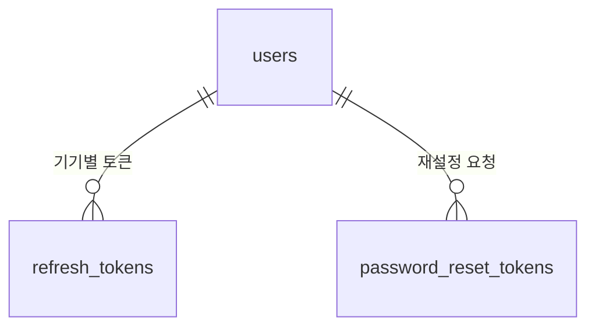

> 기준: feature/be3-admin-users (스펙 007) · 최종 확인: 2026-11-23 · 담당: BE3

# user 데이터

테이블은 JPA 엔티티로 생성된다 (`ddl-auto=update`).

## 관계

`auth_attempts`는 `users`와 연결하지 않는다. 없는 이메일의 로그인 실패도 기록해야 하기 때문에 이메일+IP 문자열을 키로 쓴다.

## users

엔티티: `User`

| 컬럼 | 설명 |
|---|---|
| id | PK. 다른 도메인의 `user_id` |
| email | 로그인 이메일. 공백 제거·소문자로 저장, UNIQUE |
| password_hash | BCrypt |
| nickname | 표시 닉네임 |
| nickname_lower | 대소문자 무시 중복 검사용, UNIQUE |
| role | `USER` · `ADMIN` (가입 시 `USER`) |
| created_at | 가입 시각 |
| token_version | Access Token 즉시 무효화용 버전 |
| status | `ACTIVE` · `SUSPENDED`. NULL은 ACTIVE로 봄 (기존 행에 추가할 수 있게 NULL 허용) |
| suspended_until | 정지 끝 시각. NULL이면 무기한 (정지 중일 때) |
| suspension_reason | 정지 사유 (최대 200자, 관리자만 봄) |
| suspended_at | 정지한 시각 |
| suspended_by | 정지한 관리자 회원 번호 |

## refresh_tokens

엔티티: `RefreshToken`

| 컬럼 | 설명 |
|---|---|
| id | PK |
| user_id | FK → users |
| token_hash | SHA-256 해시 (원문 저장 안 함), UNIQUE |
| expires_at | 발급 + 90일 |
| created_at | |
| revoked_at | 폐기 시각 |

## password_reset_tokens

엔티티: `PasswordResetToken`

| 컬럼 | 설명 |
|---|---|
| id | PK |
| user_id | FK → users |
| token_hash | SHA-256 해시, UNIQUE |
| expires_at | 발급 + 15분 |
| created_at | |
| used_at | 사용 시각 (1회만) |

## auth_attempts

엔티티: `AuthAttempt`

| 컬럼 | 설명 |
|---|---|
| id | PK |
| attempt_key | `login|{email}|{ip}` 또는 `reset|{email}|{ip}`, UNIQUE |
| attempt_count | 현재 집계 창 안의 시도 수 |
| window_started_at | 집계 창 시작 |
| locked_until | 잠금 해제 시각 |

## 삭제

회원 탈퇴는 `UserWithdrawnEvent`를 발행하고, 같은 트랜잭션에서 review·reward·dday·reading 리스너가 그 사용자의 데이터를 먼저 지운다. reading은 인증 → 세션 → 독서 기록 → 책 순서로 지운다.
