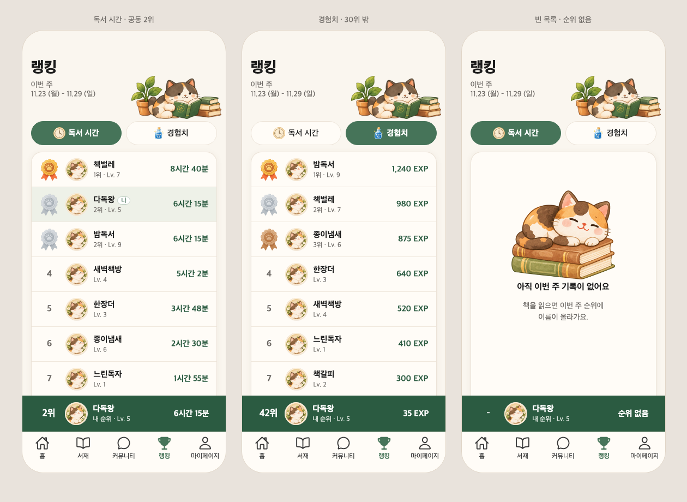

> 상태: in-progress (FE1 승인 2026-11-24) · 작성: 2026-11-24 · 기준: feature/008-ranking-screen@80bf48f · 담당: FE1 · 승인: FE1
> 요구사항: [requirements.md](./requirements.md)

# 008 · 랭킹 화면 — Design

## ① 흐름

```
[하단 탭 랭킹] ─▶ /fe1/ranking ─▶ RankingScreen ─▶ useWeeklyRanking(종류) ─▶ rankingApi
   ├─ 독서 시간 ── GET /api/rewards/rankings/weekly/reading-time ─▶ 서버 (스펙 005)
   └─ 경험치 ──── GET /api/rewards/rankings/weekly/experience ───▶ 서버 (스펙 005)
   (서버 병합 전, 개발 빌드에서만: devMockRankingApi)
```

- 랭킹 종류는 값(`readingTime`·`experience`)으로 받는다. 목록과 내 순위 컴포넌트는 두 종류가 같이 쓴다.
- 종류를 바꾸면 그 종류의 순위를 불러온다. 먼저 보낸 요청의 응답이 늦게 와도 지금 고른 종류의 화면을 덮어쓰지 않는다.
- 화면에 다시 들어오면 새로 불러온다. 이미 보여 준 순위가 있으면 다시 불러오는 동안 그대로 둔다 (R4.1, R4.4).
- 다시 불러오다 실패하면 전에 보이던 순위를 그대로 둔다. 보여 줄 순위가 없을 때 오류 화면을 띄운다 (R4.2).
- 앱으로 돌아오면(`AppState` `active`) 받은 순위의 `weekEndDate`가 한국 날짜 오늘보다 앞일 때만 다시 불러온다. 비교는 기기 시간대와 상관없이 한국 시간(`kstToday`)으로 한다. 그래도 지난주 순위가 남아 있으면 기간 글자를 "지난주"로 바꾸고 다시 불러오기 안내를 띄운다 (R4.6). 받을 때 이미 기기 날짜가 그 주를 지나 있었으면(기기 시계가 앞섬) 지난주로 보지 않아, 다시 조회가 반복되지 않는다 (응답에 받은 날 `fetchedOn`을 붙여 비교).
- 목록을 당기면 다시 불러온다. 당겼을 때만 새로고침 표시를 보인다 (R4.7).

### 화면



| 부분 | 내용 | R |
|---|---|---|
| 위쪽 | 제목 "랭킹", 이번 주 기간 `11.23 (월) – 11.29 (일)`, 책 읽는 고양이 그림 | R2.2 |
| 전환 탭 | 독서 시간(먼저) · 경험치. 그림은 시계와 EXP 물약 | R2.1 |
| 목록 항목 | 순위 · 프로필 고양이 그림 · 닉네임 · `Lv. n` · 점수 | R2.3, R2.4 |
| 점수 | 독서 시간은 `formatDurationWithSeconds`(`6시간 15분 3초`), 경험치는 `1,240 EXP` | R2.5 |
| 1~3위 | 금·은·동 메달과 작은 글씨 순위. 메달은 목록 순서가 아니라 서버 `rank`로 정한다 (공동 2위는 은메달 2개) | R2.4, R2.7 |
| 내 항목 | 연두색 배경과 "나" 표시 (`me`) | R2.6 |
| 내 순위 줄 | 목록과 하단 탭바 사이에 고정. 순위 · 닉네임 · 레벨 · 점수. 공동 순위면 순위 위에 "공동" (`isTiedRank`). `rank`가 `null`이면 "–"와, 점수 0은 "이번 주 기록이 없어요", 점수가 있으면 "집계 대상이 아니에요" (`noRankMessage`) | R3 |
| 빈 목록 | 잠자는 고양이와 "이번 주 첫 기록을 남겨 보세요" 안내. 내 순위 줄은 그대로 표시 | R4.3 |
| 지난주 안내 | 전환 탭 아래 "지난주 순위예요 · 다시 불러오기" (누르면 다시 불러옴) | R4.6 |
| 로딩·오류 | 기존 `LoadingView`·`ErrorView` | R4.1, R4.2 |

- 순위 항목과 내 순위의 그림은 모두 `profile-cat.png`로 통일한다 (홈·마이페이지와 같은 이미지). 사용자 프로필 사진이 아니다 (API에 사진이 없음). 레벨은 글자로만 구분한다.
- 30위 동점이거나 닉네임을 찾지 못한 사용자가 있으면 목록에 내가 없거나 30명보다 적을 수 있다. 앱이 순위를 다시 계산하지 않는다. 30명 밖의 동점은 서버가 알려주지 않아 "공동"을 표시하지 못한다.
- 순위 항목은 누를 수 없다 (프로필 보기는 범위 밖).
- 순위가 없는 이유는 서버가 주지 않는다. 점수로 추론하므로, 서버가 다른 제외 기준을 추가하면 다시 확인한다.

### 예시 데이터

- `RANKING_USE_DEV_MOCK`을 `__DEV__`와 함께 확인한다. 출시용 앱은 값과 상관없이 서버를 부른다 (R4.5).
- 서버 API가 main에 병합되면 `false`로 바꾸고 실제 연결을 확인한다. `FE1_USE_DEV_MOCK`은 건드리지 않는다.

## ② 바뀌는 것

| 구분 | 변경 | 관련 R |
|---|---|---|
| API | 없음 (스펙 005의 API 2개를 앱에서 부르기 시작) | R2, R3 |
| DB | 없음 | |
| 비즈니스 규칙 | 없음 | |
| 앱 | 화면 `/fe1/ranking` 추가, 하단 탭 4개 → 5개 | R1 |

## ③ 수정할 파일

| 파일 | 변경 내용 |
|---|---|
| `frontend/src/constants/routes.ts` | 공용. `fe1.ranking` 추가 |
| `frontend/src/components/BottomTabBar.tsx` | 공용. 커뮤니티와 마이페이지 사이에 랭킹 탭(트로피) 추가 |
| `frontend/src/app/_layout.tsx` | 공용. 탭 화면 목록 `fe1`에 `ranking` 추가 |
| `frontend/src/app/fe1/_layout.tsx` | 랭킹 화면 전환 애니메이션 없음 |
| `frontend/src/app/fe1/ranking.tsx` | 새로 만듦. 라우트 |
| `frontend/src/features/fe1/constants/routes.ts` | 탭바가 있는 화면 목록에 랭킹 추가 |
| `frontend/src/features/fe1/constants/config.ts` | `RANKING_USE_DEV_MOCK` 추가 |
| `frontend/src/features/fe1/types/ranking.ts` | 새로 만듦. 응답 타입 |
| `frontend/src/features/fe1/api/rankingApi.ts` | 새로 만듦. API 2개 |
| `frontend/src/features/fe1/api/devMockRankingApi.ts` | 새로 만듦. 개발용 예시 데이터 |
| `frontend/src/features/fe1/hooks/ranking/useWeeklyRanking.ts` | 새로 만듦. 조회·다시 불러오기 |
| `frontend/src/features/fe1/components/ranking/RankingTabs.tsx` | 새로 만듦. 그림이 있는 전환 탭 |
| `frontend/src/features/fe1/components/ranking/RankingListItem.tsx` | 새로 만듦. 순위 항목 |
| `frontend/src/features/fe1/components/ranking/MyRankingBar.tsx` | 새로 만듦. 내 순위 줄 |
| `frontend/src/features/fe1/components/ranking/rankingImages.ts` | 새로 만듦. 메달·고양이 그림 연결 |
| `frontend/src/features/fe1/screens/RankingScreen.tsx` | 새로 만듦. 화면 |
| `frontend/src/features/fe1/utils/format.ts` | `formatDurationWithSeconds`, `kstToday` 추가 (2026-11-28) |
| `frontend/src/features/fe1/assets/ranking/` | 은·동 메달 이미지 2개 추가 (`stats-medal.png`의 색만 바꿈) |

## ④ 고칠 docs 문서

- [ ] `docs/architecture.md` — FE1 화면 목록, 라우트 표, API 파일 표
- [ ] `docs/domains/reward/overview.md` — 랭킹 화면 위치, 현재 상태 (스펙 005 병합 뒤 겹치지 않게)
- [ ] `docs/overview.md` — 랭킹 상태
- [ ] `docs/known-issues.md` — TODO-30 해결 처리 (PR 병합 후 main에서)

## ⑤ 남은 질문 (❓)

- 없음

---

## 변경 기록

| 날짜 | 바뀐 내용 | 이유 | 결정 |
|---|---|---|---|
| 2026-11-28 | 독서 시간을 초까지 표시, 공동 순위·순위 없음 이유 표시, 주가 바뀌면 다시 조회와 지난주 안내, 당겨서 새로고침, 빈 목록 문구 (R2.5·R3.2 변경, R3.4·R3.5·R4.6·R4.7 추가). `utils/format.ts` 수정 추가 | ASK-16·19·20, TODO-44 결정 | FE1 (추천대로) |
| 2026-11-28 | 기기 시계가 앞서 있으면 앱 복귀 때마다 다시 조회하던 문제 막음 (받은 날 기준 비교) | TODO-44 엣지 케이스 | FE1 |
